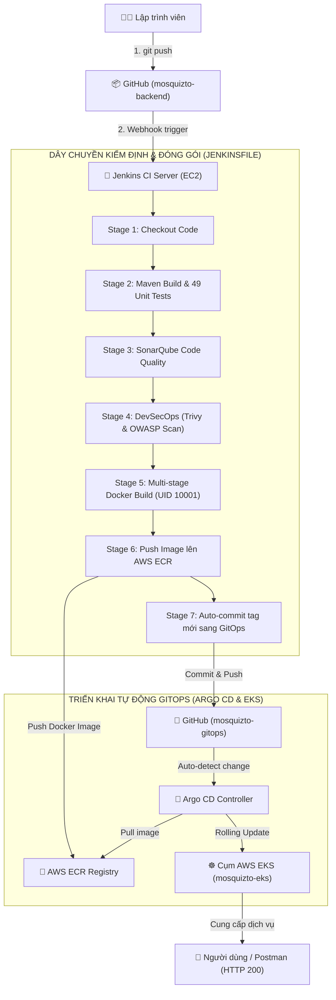

# 🚀 KIẾN TRÚC & LUỒNG VẬN HÀNH PIPELINE CI/CD
## Đồ án môn học: NT548 — Công nghệ DevOps và ứng dụng
**Thành viên phụ trách:** Thành viên 3 — Huy (CI, Ứng dụng Java & Docker)  
**Repository:** `mosquizto-backend`  
**Liên kết tích hợp:** `mosquizto-gitops` & Cụm AWS EKS

---

## 1. Bức tranh tổng quan dòng chảy Pipeline (End-to-End Flow)

Dây chuyền tự động hóa được thiết kế theo triết lý **Pipeline as Code** bằng cú pháp *Declarative Pipeline* của Jenkins. Pipeline kết nối mã nguồn Java Spring Boot với cụm máy chủ AWS EKS thông qua kho lưu trữ container AWS ECR và bộ điều khiển GitOps Argo CD:

---

## 2. Chi tiết 7 giai đoạn (Stages) trong Jenkinsfile

| Thứ tự | Tên Stage | Lệnh thực thi chính | Mục đích & Tiêu chí nghiệm thu |
| :---: | :--- | :--- | :--- |
| **1** | **Checkout Code** | `checkout scm` | Kéo toàn bộ mã nguồn nhánh mới nhất từ GitHub về thư mục làm việc của Jenkins. |
| **2** | **Maven Build & Test** | `./mvnw clean test -B` | Biên dịch và chạy tự động **49 bài Unit Test** độc lập trên H2 In-Memory Database. **Tiêu chí:** `0 failures, 0 errors`. Nếu có 1 bài test lỗi, dừng pipeline ngay lập tức. |
| **3** | **SonarQube Analysis** | `script { ... }` | Phân tích chất lượng mã nguồn tĩnh (Static Analysis), phát hiện Code Smells, Bugs tiềm ẩn và lỗ hổng bảo mật cơ bản. |
| **4** | **Security Scan** | `bash security/trivy-scan.sh` `bash security/dependency-check.sh` | Chốt chặn DevSecOps: Quét lỗ hổng thư viện Java bên thứ ba (OWASP) và quét X-quang hệ điều hành container (Trivy). Tự động bỏ qua an toàn nếu script chưa được bàn giao. |
| **5** | **Docker Build** | `docker build -t ... .` | Đóng gói mã nguồn Java thành Docker Image dựa trên `Dockerfile` tối ưu đa tầng (layertools). Chạy an toàn với user không có quyền root (`appuser:10001`). |
| **6** | **Push to AWS ECR** | `aws ecr get-login-password \| docker login ...` `docker push ...` | Sử dụng quyền `LabRole` của máy ảo EC2 để đăng nhập bảo mật vào AWS ECR và đẩy container vào kho `821278618825.dkr.ecr.us-east-1.amazonaws.com/mosquizto-backend`. |
| **7** | **Update GitOps Repo** | `git clone ...` `sed -i ... kustomization.yaml` `git commit -m "... [skip ci]"` `git push origin main` | Sử dụng GitHub Personal Access Token để cập nhật tag mới vào file `overlays/eks/kustomization.yaml` của repo `mosquizto-gitops`. Thêm cờ `[skip ci]` để tránh tạo vòng lặp vô tận. |

---

## 3. Chiến lược quản lý nhãn phiên bản (Tagging Strategy)

Để đảm bảo hệ thống Kubernetes có thể cập nhật chính xác và có thể quay ngược phiên bản (Rollback) bất cứ lúc nào, dự án áp dụng chiến lược gắn tag kép:

1. **Tag phiên bản bất biến (Immutable Tag):**
   * Định dạng: `build-${BUILD_NUMBER}` (Ví dụ: `build-1`, `build-2`, `build-15`).
   * **Ưu điểm:** Mỗi lần Jenkins chạy, biến `${BUILD_NUMBER}` tự động tăng lên 1 đơn vị. Phiên bản mới không bao giờ ghi đè lên phiên bản cũ trong kho AWS ECR.
2. **Tag phụ trợ (Moving Tag):**
   * Định dạng: `latest`.
   * **Ưu điểm:** Luôn trỏ tới bản build thành công gần nhất phục vụ việc kiểm tra nhanh.

---

## 4. Quản lý bí mật & An toàn thông tin (Security & Credentials)

Tuân thủ nghiêm ngặt nguyên tắc **Zero Secret Hard-coded**: Tuyệt đối không lưu trữ bất kỳ mật khẩu, token hay khóa riêng tư (Private Key) nào trong mã nguồn Git.

* **GitHub Token:** Được lưu trữ trong Két sắt Jenkins với định danh `github-token`. Jenkins chỉ cấp token này vào bộ nhớ RAM tạm thời trong phạm vi khối `withCredentials` khi thực hiện đẩy commit sang repo GitOps.
* **AWS Credentials:** Được ủy quyền trực tiếp thông qua cơ chế **IAM Instance Profile (LabRole)** gắn trên máy chủ EC2. Jenkins không cần lưu file `~/.aws/credentials` mà vẫn có toàn quyền push image vào AWS ECR.
* **Phân quyền chạy Container:** Container backend chạy dưới user `appuser` (UID: 10001, GID: 10001), ngăn chặn triệt để nguy cơ leo thang đặc quyền (Privilege Escalation) trên cụm EKS.

---

## 5. Cơ chế kết nối GitOps & Đồng bộ Argo CD

Quy tắc cốt lõi của đề tài môn học: **Jenkins tuyệt đối không sử dụng lệnh `kubectl apply` để can thiệp trực tiếp vào Kubernetes Cluster**. 

Thay vào đó, cơ chế bàn giao hoạt động theo chuẩn GitOps:
1. Jenkins hoàn thành việc build và đóng gói $\rightarrow$ Đẩy Image lên AWS ECR.
2. Jenkins chỉ làm một nhiệm vụ duy nhất với GitOps: Sửa số tag mới trong file `mosquizto-gitops/overlays/eks/kustomization.yaml` và đẩy commit lên GitHub.
3. Bộ điều khiển **Argo CD** chạy bên trong EKS liên tục kiểm tra repo GitOps. Khi phát hiện commit mới, Argo CD tự động thực hiện **Rolling Update**:
   * Khởi tạo Pod mang Image mới.
   * Chờ `readinessProbe` trên endpoint `/v3/api-docs` trả về HTTP 200 thành công.
   * Ngắt lưu lượng và tắt Pod cũ một cách êm ái $\rightarrow$ **Zero Downtime Deployment**.

---

## 6. Kịch bản Rollback (Quay ngược phiên bản khi có sự cố)

Nếu phiên bản mới gặp lỗi logic nghiệp vụ sau khi đã triển khai lên Production:
* **Cách 1 (Qua giao diện Argo CD - Khuyên dùng):** Người vận hành bấm nút **History and Rollback** trên Argo CD, chọn phiên bản build ổn định trước đó (ví dụ: quay từ `build-5` về `build-4`) $\rightarrow$ EKS lập tức khôi phục app trong vòng 10 giây.
* **Cách 2 (Qua GitOps):** Dùng lệnh `git revert` lại commit thay đổi tag trên repo `mosquizto-gitops` $\rightarrow$ Argo CD sẽ tự động đồng bộ lại trạng thái mong muốn theo Git.

---

## 7. Hướng dẫn kích hoạt Pipeline

### Cách 1: Tự động qua GitHub Webhook (Khuyên dùng)
* Cấu hình Webhook trên repo `mosquizto-backend`:
  * **Payload URL:** `http://<IP-Jenkins-EC2>:8080/github-webhook/`
  * **Content type:** `application/json`
  * **Events:** `Just the push event`
* Khi lập trình viên gõ `git push`, pipeline tự động được kích hoạt ngay lập tức.

### Cách 2: Kích hoạt thủ công (Manual Trigger)
1. Đăng nhập vào web Jenkins: `http://<IP-Jenkins-EC2>:8080`.
2. Chọn job `mosquizto-backend-pipeline`.
3. Bấm nút **Build Now** trên thanh điều khiển bên trái.
